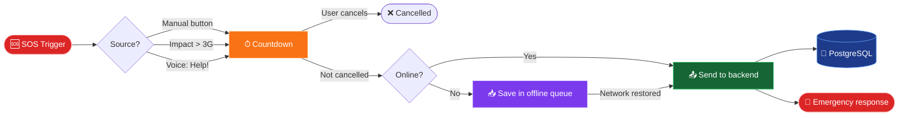
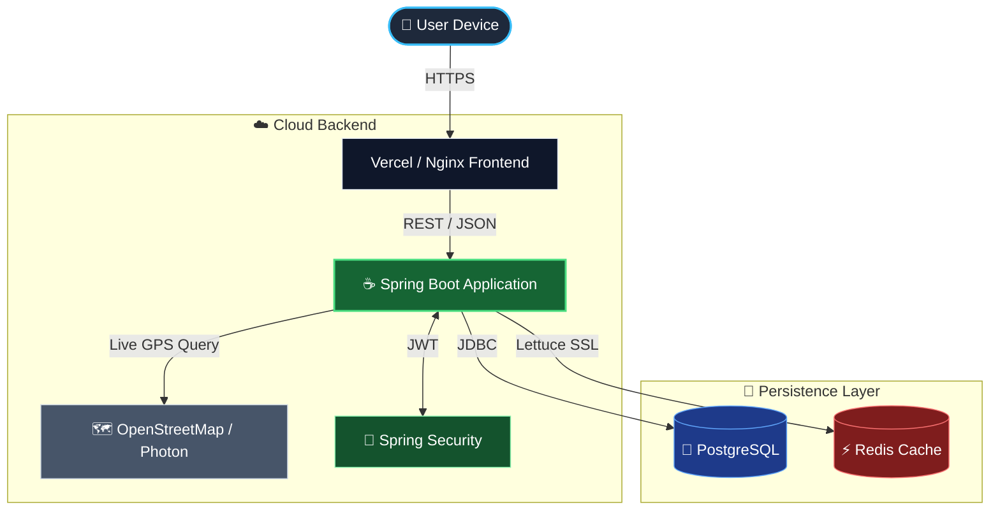
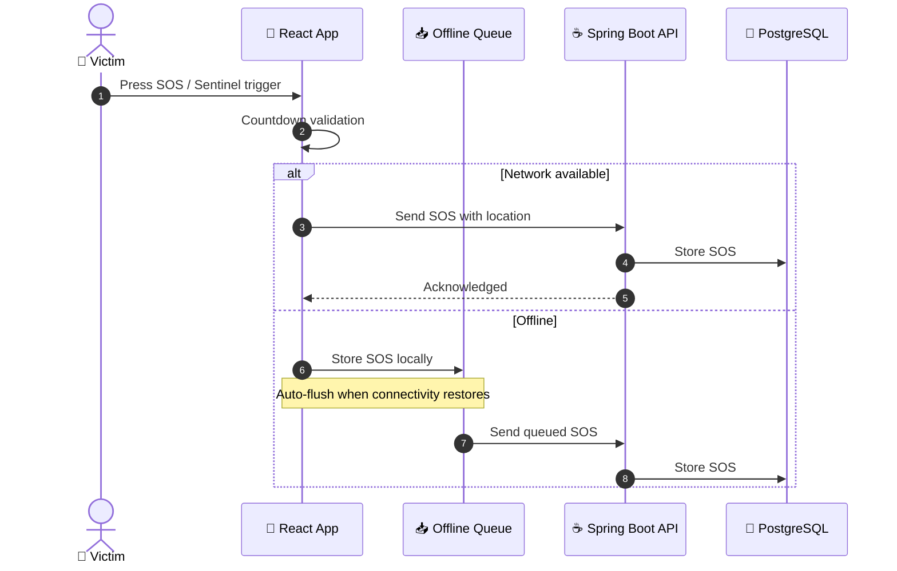
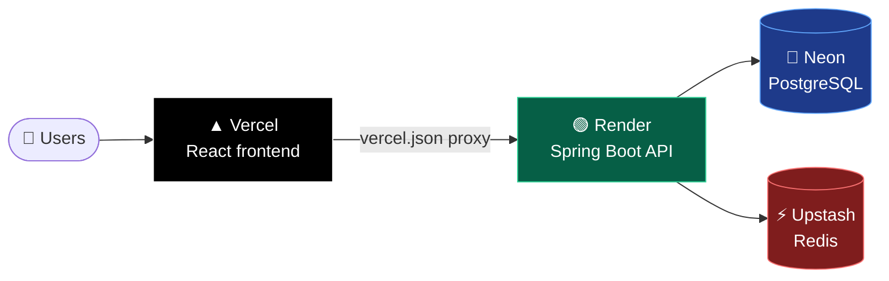
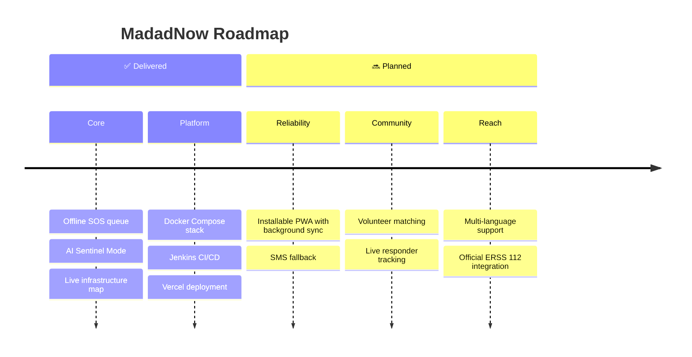

<div align="center">


<a href="https://github.com/Ankurchoudhary75/madadnow">
  
</a>

<br/>

[](https://madadnow-dyh6.vercel.app/)
[](https://github.com/Ankurchoudhary75/madadnow/stargazers)
[](https://github.com/Ankurchoudhary75/madadnow/network/members)
[](https://github.com/Ankurchoudhary75/madadnow/issues)
[](https://github.com/Ankurchoudhary75/madadnow/commits/main)
[](#-license)

<br/>


<br/><br/>

**[🚀 Live Demo](https://madadnow-dyh6.vercel.app/)** &nbsp;•&nbsp;
**[✨ Features](#-features)** &nbsp;•&nbsp;
**[⚙️ How It Works](#️-how-it-works)** &nbsp;•&nbsp;
**[🏗 Architecture](#-system-architecture)** &nbsp;•&nbsp;
**[📦 Quick Start](#-quick-start)** &nbsp;•&nbsp;
**[☁️ Deploy](#️-cloud-deployment)** &nbsp;•&nbsp;
**[🗺 Roadmap](#-roadmap)**

</div>

---

## 📑 Table of Contents

<details open>
<summary><b>Click to expand / collapse</b></summary>

1. [About the Project](#-about-the-project)
2. [Features](#-features)
3. [How It Works](#️-how-it-works)
4. [System Architecture](#-system-architecture)
5. [Tech Stack](#-tech-stack)
6. [Project Structure](#-project-structure)
7. [Quick Start](#-quick-start)
8. [Cloud Deployment](#️-cloud-deployment)
9. [Design Principles](#-design-principles)
10. [Privacy & Safety](#-privacy--safety)
11. [Troubleshooting](#-troubleshooting)
12. [FAQ](#-faq)
13. [Roadmap](#-roadmap)
14. [Contributing](#-contributing)
15. [License](#-license)
16. [Author](#-author)

</details>

---

## 🎯 About the Project

> **MadadNow** (*madad* = "help" in Hindi/Urdu) is a full-stack, sensor-aware emergency management platform that bridges the gap between **victims**, **volunteers**, and the State Emergency Response Support System (**ERSS 112**).

In a real disaster the usual assumptions break: mobile networks are congested or down, users are injured or panicking, and some victims cannot operate a phone at all. MadadNow is engineered around those failures instead of ignoring them.

<table>
<tr>
<td width="50%" valign="top">

### 😰 The problem
- Networks drop exactly when they are needed most
- Panicking users cannot fill in forms or remember logins
- Injured or unconscious victims cannot tap a button
- People do not know where the nearest help actually is
- Control rooms need fast, clear, actionable alerts

</td>
<td width="50%" valign="top">

### 🛡️ The MadadNow answer
- **Queue the SOS offline**, send it the moment the network returns
- **One-action SOS** with a short countdown to prevent false alarms
- **Sensor-based triggers** for impacts and spoken distress cues
- **Live map** of hospitals, police stations and NGOs near you
- **Command-style UI** built for emergency control rooms

</td>
</tr>
</table>

> [!IMPORTANT]
> MadadNow is a software project and **not an official government service**. In a real emergency, always call **112** (or your local emergency number) directly.

---

## ✨ Features

<div align="center">

| | Feature | What it does |
| :---: | :--- | :--- |
| 📡 | **Offline-First Queueing** | Trigger SOS payloads with **no connectivity**. Nearby shelters are cached on the device, and the queued SOS is **flushed automatically** when the network is restored. |
| 🤖 | **AI Sentinel Mode** | Watches the **accelerometer** and **microphone** for impacts above **3 G** or audio distress cues such as *"Help!"* and starts the SOS sequence if the victim may be incapacitated. |
| 🗺️ | **Live Infrastructure Map** | Uses **OpenStreetMap / Photon APIs** to locate Government Hospitals, Police Stations and NGOs within a **25 km radius**, drawn with **Leaflet.js**. |
| 🚨 | **ERSS 112 Command UI** | Panic-proof interface designed for State Emergency Control Rooms, with **countdown validation** and **rapid-action workflows**. |
| 🔐 | **Secure Backend** | Stateless **JWT** authentication with **Spring Security** and request rate limiting. |
| ⚡ | **Cached Lookups** | **Redis** (Lettuce over TLS) accelerates repeated queries and reduces load on external APIs. |
| 🐳 | **One-Command Setup** | Entire stack (frontend, backend, PostgreSQL, Redis) runs through **Docker Compose**. |
| 🔁 | **CI/CD Ready** | **Jenkins** pipeline for automated testing and Docker image builds. |

</div>

### 🔍 Feature deep dive

<details>
<summary><b>📡 Offline-First Queueing: how SOS survives a dead network</b></summary>
<br/>

1. The user (or Sentinel Mode) raises an SOS and the app builds the payload on the device.
2. If the network is unavailable, the SOS is **stored locally in a queue** instead of failing.
3. Nearby shelters that were cached earlier remain visible, so the user still has guidance.
4. When connectivity returns, the app **detects it and flushes the queue** to the backend.

The goal is simple: **an SOS is never silently lost.**

</details>

<details>
<summary><b>🤖 AI Sentinel Mode: help for people who cannot ask for it</b></summary>
<br/>

| Signal | Sensor | Trigger |
| :--- | :--- | :--- |
| 💥 Hard impact (fall, collision, crash) | Accelerometer | Force greater than **3 G** |
| 🗣️ Spoken distress cue | Microphone | Phrases such as **"Help!"** |

When a signal fires, the app starts the **SOS countdown**. If the user is conscious they can cancel; if not, the SOS goes out automatically (or is queued if offline).

</details>

<details>
<summary><b>🗺️ Live Infrastructure Map: find help fast</b></summary>
<br/>

- Reads the user's live GPS position
- Queries **OpenStreetMap / Photon** for emergency facilities
- Shows **Government Hospitals**, **Police Stations** and **NGOs** within **25 km**
- Renders results on an interactive **Leaflet** map

</details>

<details>
<summary><b>🚨 ERSS 112 Command UI: designed for panic</b></summary>
<br/>

- Large, high-contrast controls that work under stress
- **Countdown validation** to stop accidental dispatch
- **Rapid-action workflows** for quick handling in control-room scenarios

</details>

---

## ⚙️ How It Works



### 🧭 User journey

| Step | What the user does | What MadadNow does |
| :---: | :--- | :--- |
| **1** | Opens the app (or enables Sentinel Mode) | Gets GPS location and caches nearby shelters |
| **2** | Presses SOS, or an impact / "Help!" is detected | Starts a cancellable countdown |
| **3** | Does nothing, or cancels a false alarm | Sends the SOS, or aborts it |
| **4** | Has no network | Stores the SOS in the offline queue |
| **5** | Network comes back | Flushes the queue to the backend automatically |
| **6** | Looks for help | Shows the nearest hospitals, police stations and NGOs on the map |

---

## 🏗 System Architecture

MadadNow is a containerized full-stack application: a React frontend, a Spring Boot REST API, PostgreSQL for persistence and Redis for caching.



### 📨 SOS sequence



---

## 🧰 Tech Stack

<div align="center">

| Layer | Technologies |
| :---: | :--- |
| 🎨 **Frontend** |     |
| ⚙️ **Backend** |      |
| 💾 **Data** |   |
| 🌍 **Maps & Geo** |   |
| 🚢 **DevOps** |    |
| ☁️ **Hosting** |     |

</div>

<details>
<summary><b>📚 Why these choices?</b></summary>
<br/>

| Technology | Reason |
| :--- | :--- |
| **React + Vite** | Fast builds and a responsive, component-based UI |
| **Tailwind CSS** | Quick, consistent dark-mode and glassmorphism styling |
| **Leaflet.js** | Lightweight, flexible interactive maps |
| **Spring Boot** | Mature, production-ready REST API framework |
| **Spring Security + JWT** | Stateless, scalable authentication |
| **PostgreSQL** | Reliable relational storage for emergency data |
| **Redis** | Low-latency caching for repeated lookups |
| **Docker Compose** | Identical dev and prod environments in one command |
| **Jenkins** | Automated builds and tests on every change |

</details>

---

## 📁 Project Structure

```text
madadnow/
├── 📂 backend/              # Spring Boot REST API (Java 17)
├── 📂 frontend/             # React + Vite app
│   └── vercel.json          # Proxy rules for Vercel deployment
├── 📂 .vscode/              # Editor settings
├── 🐳 docker-compose.yml    # Frontend + Backend + PostgreSQL + Redis
├── 🔧 Jenkinsfile           # CI/CD pipeline definition
└── 📘 README.md
```

---

## 📦 Quick Start

### ✅ Prerequisites

| Tool | Needed for |
| :--- | :--- |
| [Docker](https://docs.docker.com/get-docker/) + Docker Compose | Running the full stack (recommended) |
| [Git](https://git-scm.com/) | Cloning the repository |

### 🐳 Run everything with Docker

```bash
# 1️⃣ Clone the repository
git clone https://github.com/Ankurchoudhary75/madadnow.git
cd madadnow

# 2️⃣ Build and start all containers (Frontend, Backend, PostgreSQL, Redis)
docker compose up -d --build

# 3️⃣ Open the app 🎉
```

| Service | URL |
| :--- | :--- |
| 🖥️ **Frontend** | http://localhost:5173 |
| ⚙️ **Backend API** | http://localhost:8080/api |

**Handy commands**

```bash
docker compose ps          # check container status
docker compose logs -f     # follow live logs
docker compose down        # stop and remove containers
docker compose up -d --build   # rebuild after code changes
```

> [!TIP]
> Allow **location**, **motion sensor** and **microphone** permissions in your browser to try Sentinel Mode and the live map. Sensor features work best on a real phone over HTTPS.

---

## ☁️ Cloud Deployment

MadadNow is optimized for serverless-style hosting. The live demo runs at **[madadnow-dyh6.vercel.app](https://madadnow-dyh6.vercel.app/)**.



### Backend environment variables

| Variable | Description |
| :--- | :--- |
| `SPRING_DATASOURCE_URL` | PostgreSQL JDBC connection string (for example from **Neon**) |
| `SPRING_REDIS_URL` | Redis connection string using `rediss://` for TLS (for example from **Upstash**) |

### Deployment steps

1. **Database:** create a PostgreSQL instance and copy its JDBC URL.
2. **Cache:** create a Redis instance and copy its `rediss://` URL.
3. **Backend:** deploy `backend/` to Render and add the variables above.
4. **Frontend:** deploy `frontend/` to Vercel. The `frontend/vercel.json` file proxies API calls to your backend.

> [!WARNING]
> Never commit real database passwords, tokens or secrets. Always use your hosting provider's environment variable settings.

---

## 🧠 Design Principles

| Principle | Meaning |
| :--- | :--- |
| 🔌 **Offline first** | The app must stay useful with no signal |
| 👆 **Fewest possible taps** | Every extra step costs seconds in an emergency |
| ⏱️ **Confirm, don't block** | A short countdown prevents false alarms without slowing real ones |
| 🙌 **Hands-free when needed** | Sensors act when the user cannot |
| 🎨 **Readable under stress** | High contrast, large targets, minimal text |
| 🔒 **Secure by default** | Stateless auth and rate limiting on the API |

---

## 🔒 Privacy & Safety

- 📍 **Location, motion and microphone** access require explicit browser permission.
- ⏱️ Automatic triggers pass through a **countdown** so accidental drops or loud noises do not immediately raise an alert.
- 📱 Sensor and audio support **varies by device and browser**; test on your target phones.
- 🗺️ Facility data comes from **OpenStreetMap** and may be incomplete or out of date.
- 🚫 This project does not replace calling **112**.

---

## 🛠 Troubleshooting

<details>
<summary><b>🐳 Ports 5173 or 8080 are already in use</b></summary>
<br/>

Stop whatever is using the port, or change the port mapping in `docker-compose.yml`, then run `docker compose up -d --build` again.

</details>

<details>
<summary><b>🔄 Containers start but the app does not load</b></summary>
<br/>

Check status and logs:

```bash
docker compose ps
docker compose logs -f
```

The backend may need a few seconds to connect to PostgreSQL and Redis on first start.

</details>

<details>
<summary><b>📍 Map or location is not working</b></summary>
<br/>

Make sure the browser has **location permission** enabled. Geolocation and sensor APIs generally require a secure context (HTTPS or `localhost`).

</details>

<details>
<summary><b>🎤 Sentinel Mode does not react</b></summary>
<br/>

Grant **microphone** and **motion sensor** permissions, and test on a real phone. Desktop browsers usually have no accelerometer.

</details>

<details>
<summary><b>☁️ API calls fail on the deployed frontend</b></summary>
<br/>

Check that `frontend/vercel.json` points to your live backend URL and that `SPRING_DATASOURCE_URL` and `SPRING_REDIS_URL` are set correctly on the backend host. Free-tier backends can take a moment to wake up after being idle.

</details>

---

## ❓ FAQ

<details>
<summary><b>Is MadadNow an official emergency service?</b></summary>
<br/>

No. It is a software project designed around the ERSS 112 model. Always call 112 in a real emergency.

</details>

<details>
<summary><b>Does Sentinel Mode send alerts instantly?</b></summary>
<br/>

It starts a **cancellable countdown** first so that false alarms can be stopped.

</details>

<details>
<summary><b>What happens to an SOS sent without internet?</b></summary>
<br/>

It is stored in a local queue and sent automatically when connectivity returns.

</details>

<details>
<summary><b>What kinds of places does the map show?</b></summary>
<br/>

Government hospitals, police stations and NGOs within a 25 km radius of your location.

</details>

---

## 🗺 Roadmap



- [x] Offline-first SOS queue with auto-flush
- [x] AI Sentinel Mode (impact and audio distress detection)
- [x] Live infrastructure map (25 km radius)
- [x] Dockerized stack with Jenkins CI/CD
- [x] Cloud deployment on Vercel
- [ ] Installable PWA with background sync
- [ ] SMS fallback when mobile data is unavailable
- [ ] Volunteer matching and live responder tracking
- [ ] Multi-language support (Hindi, Punjabi and more)
- [ ] Official ERSS 112 integration

---

## 🤝 Contributing

Contributions make open source great. Any help is **appreciated**!

```bash
# 1. Fork the project, then clone your fork
git clone https://github.com/<your-username>/madadnow.git

# 2. Create your feature branch
git checkout -b feature/amazing-feature

# 3. Commit your changes
git commit -m "feat: add amazing feature"

# 4. Push to the branch
git push origin feature/amazing-feature

# 5. Open a Pull Request 🎉
```

For major changes, please [open an issue](https://github.com/Ankurchoudhary75/madadnow/issues) first to discuss what you would like to change.

---

## 📝 License

Distributed under the **MIT License**. See the [LICENSE](https://github.com/Ankurchoudhary75/madadnow/blob/main/LICENSE) file for details.

---

## 👨‍💻 Author

<div align="center">

<a href="https://github.com/Ankurchoudhary75">
  
</a>

### **Ankur Choudhary**

[](https://github.com/Ankurchoudhary75)

<br/>

**If MadadNow inspires you, please consider giving it a ⭐**


*Built with ❤️ for public safety.*

</div>
