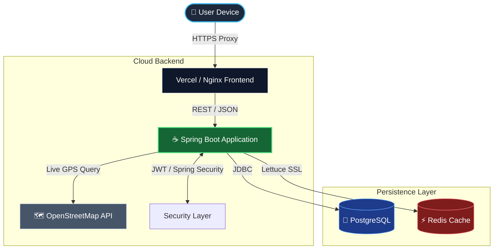

<div align="center">

# 🛡️ MadadNow 

**Next-Generation Disaster Response & Emergency Platform**

*Because every single second counts when the network goes dark.*

[](https://reactjs.org/)
[](https://spring.io/)
[](https://postgresql.org)
[](https://redis.io)
[](https://docker.com)
[](https://jenkins.io/)

[Live Demo](#) • [Installation](#-installation) • [System Architecture](#-system-architecture) • [Features](#-core-features)

</div>

---

> **MadadNow** is a full-stack, AI-powered emergency management system designed to bridge the gap between victims, volunteers, and the State Emergency Response Support System (ERSS 112). Built with a resilient offline-first architecture, it ensures that users are never truly disconnected during a crisis.

---

## ⚡ Core Features

| Feature | Description |
| :--- | :--- |
| 📡 **Offline-First Queueing** | Triggers SOS payloads completely offline. App dynamically caches local shelters and intelligently flushes the SOS queue the exact millisecond network connectivity restores. |
| 🤖 **AI Sentinel Mode** | Utilizes mobile hardware (Accelerometer & Microphone) to detect **>3 G-Force impacts** or audio distress cues ("Help!"), automatically firing SOS sequences if the victim is incapacitated. |
| 🗺️ **Live Infrastructure Map** | Integrates dynamically with **OpenStreetMap / Photon APIs** to pinpoint the absolute nearest Government Hospitals, Police Stations, and NGOs within a 25km radius. |
| 🛡️ **ERSS 112 Command** | Panic-proof UI explicitly designed for integration into State Emergency Control Rooms, featuring countdown validations and rapid-action workflows. |

<br/>

## 🏗 System Architecture

MadadNow is engineered as a robust, containerized microservice application capable of handling high-throughput disaster events.



<details>
<summary><b>Click to view Tech Stack Breakdown</b></summary>

### Frontend Engineering
- **React.js 19 (Vite):** Ultra-fast compilation and state management.
- **Tailwind CSS:** Modern Glassmorphism and responsive dark-mode styling.
- **Leaflet.js:** Advanced geospatial rendering and interactive mapping.

### Backend Engineering
- **Java 17 & Spring Boot 3:** High-performance, multi-threaded REST APIs.
- **Spring Data JPA & Hibernate:** ORM mapping for complex relational emergency data.
- **Spring Security:** Stateless JWT-based authentication and rate limiting.

### DevOps & Infrastructure
- **Docker & Docker Compose:** 100% containerized environments for identical Dev/Prod parity.
- **Jenkins CI/CD:** Automated pipeline testing and Docker image builds.
- **Nginx:** Reverse proxying and load balancing for React static assets.
</details>

---

## 💻 Installation

### Option A: Local Containerized Deployment (Recommended)
You can spin up the entire isolated stack (Frontend, Backend, Postgres, Redis) using our Docker orchestration.

```bash
# 1. Clone the repository
git clone https://github.com/YourUsername/madadnow.git
cd madadnow

# 2. Build the multi-stage Docker containers
docker compose up -d --build

# 3. App is instantly live
# Frontend -> http://localhost:5173
# Backend  -> http://localhost:8080/api
```

### Option B: Cloud Serverless Deployment
MadadNow is optimized for serverless deployments on platforms like Render and Vercel. 
Simply inject the following environment variables into your Cloud provider:
* `SPRING_DATASOURCE_URL` (Neon Postgres JDBC String)
* `SPRING_REDIS_URL` (Upstash Rediss Connection)
* *The `frontend/vercel.json` file will automatically handle Nginx-style proxying to your backend.*

---

## 🎨 Application Previews

*(Replace these placeholders with actual screenshots or GIFs of your app)*

> 
> 

---

## 📝 License

This project is licensed under the MIT License - see the [LICENSE](LICENSE) file for details. Built with ❤️ for public safety.
